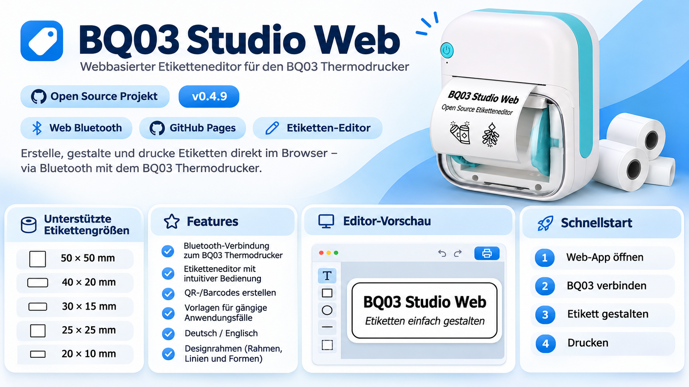

  

<h1 align="center">BQ03 Studio Web</h1>

  <strong>Etiketten direkt im Browser gestalten und über Bluetooth drucken.</strong> 
  <em>Design and print labels directly in your browser via Bluetooth.</em>

  <strong>v0.4.9</strong> · Web Bluetooth · GitHub Pages · Deutsch / English

  <a href="https://oldbug62.github.io/BQ03-WebApp/"><strong>▶ Web-App starten / Launch web app</strong></a>

**Sprache / Language:** [Deutsch](#deutsch) · [English](#english)

---

## 🇩🇪 Deutsch

**BQ03 Studio Web** ist ein unabhängiger, browserbasierter Etiketteneditor für den **BQ03-Thermodrucker**. Etiketten lassen sich erstellen, bearbeiten und direkt über **Web Bluetooth** an den Drucker senden – ohne zusätzliche Drucker-App und ohne Cloud-Anmeldung.

**Gerätemarke (laut Produktangebot): heuchaey · Modell: BQ03.** BQ03 Studio Web ist ein unabhängiges Community-Projekt und steht nicht in offizieller Verbindung zur Marke oder zum Hersteller.

### 🚀 Schnellstart

1. **[Web-App öffnen](https://oldbug62.github.io/BQ03-WebApp/)** – in einer aktuellen Version von **Chrome oder Edge**.
2. **BQ03 einschalten** und in der Web-App auf **„Bluetooth verbinden“** klicken.
3. **Etikettenformat auswählen** und Text, Bilder, Rahmen oder Codes gestalten.
4. **„Drucken“** anklicken und das Etikett ausgeben.

> **Hinweis:** Web Bluetooth benötigt einen kompatiblen Browser und eine sichere HTTPS-Seite. Der BQ03 muss eingeschaltet und in Bluetooth-Reichweite sein. Gegebenenfalls zuvor andere Apps vom Drucker trennen.

### ✨ Funktionen

- **Visueller Etiketteneditor:** Text und Bilder verschieben, skalieren und drehen.
- **Textgestaltung:** Schriftarten und -größen, links/zentriert/rechts, fett, kursiv, unterstrichen sowie mehrzeiliger Text.
- **Designrahmen:** Verschiedene Rahmenstile und ein optionaler 1-mm-Hilfsrahmen in der Vorschau.
- **Grafiken und Codes:** PNG/JPG/WebP, SVG-Import, QR-Code, EAN-13 und Code 128.
- **Präzises Arbeiten:** Zoom, Raster, Ausrichtung, Zentrierung, Duplizieren sowie Rückgängig/Wiederholen.
- **Druckfunktionen:** Formatbezogene Kalibrierung, Kopien, Seriennummern und Druckraster-Vorschau.
- **Vorlagen:** Lokal speichern und laden sowie als JSON exportieren/importieren.
- **Mehrsprachig:** Deutsch und Englisch.

### 📐 Etikettenformate

| Format (Breite × Höhe) | Stand |
| :-- | :-- |
| **40 × 20 mm** | ✅ Am echten BQ03 erfolgreich getestet; Druckgeometrie abgestimmt |
| 50 × 50 mm | In der App vorhanden; Hardwarekalibrierung noch nicht bestätigt |
| 30 × 15 mm | In der App vorhanden; Hardwarekalibrierung noch nicht bestätigt |
| 25 × 25 mm | In der App vorhanden; Hardwarekalibrierung noch nicht bestätigt |
| 20 × 10 mm | In der App vorhanden; Hardwarekalibrierung noch nicht bestätigt |

Zusätzlich lassen sich benutzerdefinierte Maße im Editor einstellen. Die tatsächliche Bedruckbarkeit ist von Papier, Druckkopf und Papiervorschub abhängig.

### 💻 Voraussetzungen

- Ein **BQ03-Thermodrucker** mit passender Etikettenrolle.
- Ein Gerät mit **Bluetooth** sowie ein Browser mit **Web-Bluetooth-Unterstützung** (z. B. Chrome oder Edge auf einem unterstützten System).
- Zugriff auf die **[Web-App](https://oldbug62.github.io/BQ03-WebApp/)** über HTTPS.

Die Web-App läuft im Browser. Die Kommunikation mit dem Drucker erfolgt lokal per Bluetooth. Gespeicherte Vorlagen und der Druckverlauf liegen im lokalen Browserspeicher, sofern dieser verfügbar ist. Daten werden nicht zum Drucken an einen externen Server übertragen.

### 🧪 Projektstatus

Aktuelle dokumentierte Version: **0.4.9**. Die Bluetooth-Verbindung und der Druck auf **40 × 20 mm** wurden am echten Drucker bestätigt. Die übrigen Formate sind implementiert, aber noch nicht vollständig durch echte Drucktests kalibriert. Der Funktionsumfang kann sich mit weiteren Versionen ändern.

---

## 🇬🇧 English

**BQ03 Studio Web** is an independent, browser-based label editor for the **BQ03 thermal printer**. Create and edit labels, then send them directly to the printer using **Web Bluetooth** — no separate printer application or cloud sign-in required.

**Device brand (as listed by the seller): heuchaey · Model: BQ03.** BQ03 Studio Web is an independent community project and is not officially affiliated with the brand or device manufacturer.

### 🚀 Quick start

1. **[Open the web app](https://oldbug62.github.io/BQ03-WebApp/)** in an up-to-date **Chrome or Edge** browser.
2. **Turn on the BQ03**, then select **Connect Bluetooth** in the app.
3. **Choose a label size** and arrange text, images, borders, or codes.
4. Select **Print** to send the label to the printer.

> **Note:** Web Bluetooth requires a compatible browser and a secure HTTPS page. Keep the printer powered on and within Bluetooth range. Disconnect it from other printer apps if necessary.

### ✨ Features

- **Visual label editor:** Move, resize, and rotate text and images.
- **Typography:** Font families and sizes, left/center/right alignment, bold, italic, underline, and multiline text.
- **Decorative borders:** Several printable border styles and an optional 1 mm on-screen guide.
- **Images and codes:** PNG/JPG/WebP, SVG import, QR codes, EAN-13, and Code 128.
- **Editing tools:** Zoom, grid, alignment, centering, duplicate, undo, and redo.
- **Printing tools:** Per-size calibration, multiple copies, serial numbers, and a print-raster preview.
- **Templates:** Save and load locally; import and export JSON layouts.
- **Languages:** German and English.

### 📐 Supported label sizes

| Width × height | Status |
| :-- | :-- |
| **40 × 20 mm** | ✅ Successfully tested on a physical BQ03; print geometry calibrated |
| 50 × 50 mm | Available in the app; physical calibration not yet confirmed |
| 30 × 15 mm | Available in the app; physical calibration not yet confirmed |
| 25 × 25 mm | Available in the app; physical calibration not yet confirmed |
| 20 × 10 mm | Available in the app; physical calibration not yet confirmed |

Custom dimensions are also available in the editor. The usable print area depends on the label stock, printhead, and paper feed.

### 💻 Requirements

- A **BQ03 thermal printer** and compatible label stock.
- A **Bluetooth-enabled device** and a browser supporting **Web Bluetooth** (such as Chrome or Edge on a supported platform).
- Access to the **[web app](https://oldbug62.github.io/BQ03-WebApp/)** over HTTPS.

The application runs in your browser and talks directly to the printer over local Bluetooth. Templates and print history are stored locally in your browser when local storage is available. Print data is not uploaded to a remote server.

### 🧪 Project status

Latest documented version: **0.4.9**. Bluetooth and **40 × 20 mm** printing have been confirmed with a physical BQ03. The other listed formats are implemented but have not all been fully calibrated through real-world print tests.

---

## 📄 Lizenz / License

**Deutsch:** BQ03 Studio Web wird unter der [MIT-Lizenz](LICENSE) veröffentlicht. Hinweise auf enthaltene Drittanbieter-Komponenten stehen in [LICENSE-THIRD-PARTY.txt](LICENSE-THIRD-PARTY.txt). Deren eigene Lizenzbedingungen bleiben gültig.

**English:** BQ03 Studio Web is released under the [MIT License](LICENSE). Notices for included third-party components are in [LICENSE-THIRD-PARTY.txt](LICENSE-THIRD-PARTY.txt). Their respective license terms continue to apply.

---

  <a href="https://oldbug62.github.io/BQ03-WebApp/"><strong>▶ BQ03 Studio Web öffnen / Open BQ03 Studio Web</strong></a>

Unabhängiges Community-Projekt / Independent community project. Keine offizielle Hersteller-App / Not an official manufacturer application.
